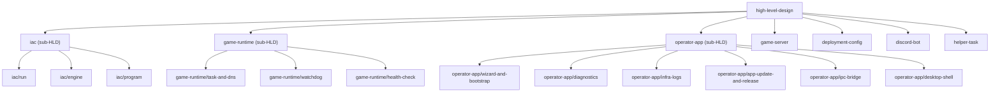
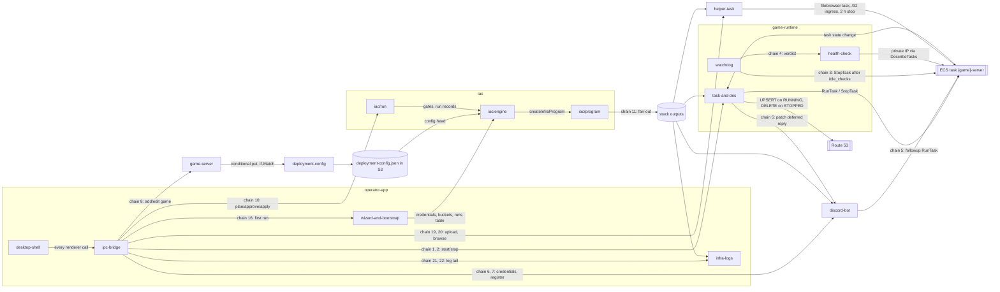

# High-Level Design: Hyveon

This is the root of Hyveon's design tree, bootstrapped from a brownfield `/map-codebase` sweep at git SHA `2822efd1` (lens: domain concept, 16 leaves under 3 grouping nodes).
It describes what exists today, grounded in code, `CLAUDE.md`, `README.md` and `docs/docs/architecture.md`; where no such source states an intent, the section is marked `*(not yet specified)*` rather than filled with placeholder prose.
Statements marked `[inferred]` are the mapper's reading of the code and should be confirmed or refuted during flesh-out.

## Problem

Dedicated game servers cost money every hour they run, whether or not anyone is playing, and the usual self-hosted setups need an always-on machine plus a bot process to let players start them.
Hyveon exists so that servers "only run, and only cost money, while someone is playing" (`README.md`, intro), with no persistent ECS Service, no idle costs and no 24/7 Discord bot process (`README.md`, "What you get").
Who suffers and why now are not stated in any grounding source: *(not yet specified)*.

## Approach

Three loosely coupled pieces share types and helpers through one workspace package, `@hyveon/shared` (`docs/docs/architecture.md`, intro).

### On-demand game tasks on Fargate

Game servers exist only while an ECS `RunTask` is in flight: Start issues `ecs.runTask`, Stop issues `ecs.stopTask`, and a scheduled watchdog Lambda stops tasks that look idle (`docs/docs/architecture.md`, "Why Pulumi"; `README.md`, "What you get").
Players connect straight to the task's public IP; a Lambda keeps `{game}.yourdomain.com` pointed at it, and HTTPS games terminate TLS in-task through a Caddy sidecar with no load balancer anywhere in the path (`docs/docs/architecture.md`, "Game plane and operator control").

### A packaged desktop app as the local control plane

A packaged Electron app (React/Vite renderer, Nest.js backend over Electron IPC, not HTTP) is the operator's only surface (`docs/docs/architecture.md`, intro).
It provisions every AWS resource itself through a Pulumi Automation API program with a self-provisioned pinned engine, so there is no host-installed CLI (`CLAUDE.md:65-68`), and it discovers the deployed stack from Pulumi stack outputs held in an S3 state backend.

### Serverless control flow in Lambdas

Six Lambda packages run the control flow: two for Discord slash commands, one for DNS, one for the idle watchdog, plus a conditional shared health-check function and a conditional per-game EFS seeder (`docs/docs/architecture.md`, intro).

## Target Users

`README.md` ("Documentation") organises the product around three roles: someone who installs and runs the packaged app, an operator going from a blank AWS account to a running Fargate task and then driving it day to day, and a maintainer working on the codebase.
The Discord bot additionally serves players, who start, stop and check games from slash commands under the operator's allowlists (`README.md`, "What you get").
Needs and acceptable cost per role are not stated: *(not yet specified)*.

## Goals

> **DRAFT: needs owner review.** Drafted from `README.md` and `docs/docs/architecture.md`; not yet confirmed by the project owner. Edit or strike freely.

1. **No idle compute cost.** When no one is playing, no game compute bills: no persistent ECS Service, no load balancer, no always-on bot host. Only storage and per-request services remain.
2. **Blank AWS account to a running game server from inside the app.** One operator on one machine goes from first launch to a running server through the packaged app alone, with no host-installed CLI and no console work beyond the guided CloudFormation upload.
3. **Players self-serve.** Allowlisted Discord users start, stop and check servers from slash commands without the operator present and without a 24/7 process.
4. **Adding a game is one config entry.** Every per-game resource fans out from one `gameServers` map entry.
5. **Worlds survive restarts.** A game's saves persist across task stops and starts.

## Non-Goals

The following are stated as prohibitions in `CLAUDE.md` ("Invariants that hurt to break") and `docs/docs/architecture.md` ("Invariants"), and function as boundaries the project will not cross:

- No persistent ECS Service; a long-running Service destroys the core cost model (`CLAUDE.md:79-81`).
- No ALB, target group or ACM certificate anywhere in the stack (`CLAUDE.md:90-91`).
- No Pulumi-managed per-game DNS record; `route53.ts` declares zero resources (`CLAUDE.md:86-89`).
- No discord.js, no gateway connection, no bot process, and no global slash-command registration (`CLAUDE.md:95-96`).
- No HTTP transport, bearer token or API server in the desktop app (`CLAUDE.md:101-102`).
- No secret values in the renderer; only `botTokenSet` / `publicKeySet` style booleans cross (`CLAUDE.md:99-100`).
- No DynamoDB or SSM store for watchdog state (`CLAUDE.md:92`).
- No host-installed `pulumi` binary and no CLI-based IaC step (`CLAUDE.md:65-68`).
- No second copy of `canRun()`; the permission logic is never forked (`CLAUDE.md:97-98`).

Product-level non-goals beyond these invariants (for example which games, clouds or team sizes are out of scope) are not stated: *(not yet specified)*.

## Tenets

Tie-breakers for choices no spec anticipates. Every sub-HLD and leaf inherits them.

- **One copy of every rule.** Shared logic (validators, permission checks, data shapes) lives once in `@hyveon/shared` and every consumer imports it, even when that couples bundles; never fork a rule to keep a package self-contained.
- **Pollers degrade, editors fail loudly.** Background readers tolerate failure and show stale or empty state quietly; operator-initiated writes surface every failure.
- **Fail active.** When a server's liveness is uncertain, keep it running; an extra stretch of cost beats stopping a game someone is playing.
- **Humans gate both ends of a release.** A person cuts every release and a person approves every install; nothing ships or updates silently.

## System Design

### Design tree

Three grouping nodes (sub-HLDs) and sixteen leaves, each a folder under `docs/intent/` holding `<node>-design.md` and `<node>-specs.md`.

### Main runtime data flows

Derived from the cross-layer behaviour chains in `docs/arrows/_map-codebase/inventory.md` §2 (chain numbers in edge labels).
Edges run between leaves; AWS services are shown only where a chain crosses them.

### Node table

| Node | Kind | Purpose | Design doc path | Specs prefix |
|---|---|---|---|---|
| `iac` | sub-HLD | Turning the operator's declared setup into real AWS resources, safely and with a record of every attempt. | `docs/intent/iac/iac-design.md` | `IAC` (namespace root, owns no EARS) |
| `iac/run` | leaf | Each plan / apply / destroy / rollback attempt as a durable record, plus the IaC, history and run-detail pages. | `docs/intent/iac/run/run-design.md` | `IAC-RUN` |
| `iac/engine` | leaf | Runs Pulumi inside the app: pinned engine download, workspace, credentials, cancellation, lock recovery, cached outputs. | `docs/intent/iac/engine/engine-design.md` | `IAC-ENGINE` |
| `iac/program` | leaf | The inline Pulumi program describing every AWS resource and the `StackOutputs` it hands back. | `docs/intent/iac/program/program-design.md` | `IAC-PROGRAM` |
| `game-runtime` | sub-HLD | What happens to a game while it is deployed: starting, stopping, DNS, idle shutdown and liveness verdicts. | `docs/intent/game-runtime/game-runtime-design.md` | `RT` (namespace root, owns no EARS) |
| `game-runtime/task-and-dns` | leaf | Start and stop a game's container on demand, publish its address in DNS, show live status and estimated cost. | `docs/intent/game-runtime/task-and-dns/task-and-dns-design.md` | `RT-TASK` |
| `game-runtime/watchdog` | leaf | Automatically stop a game nobody is playing, keeping its idle counter in an ECS task tag. | `docs/intent/game-runtime/watchdog/watchdog-design.md` | `RT-WATCHDOG` |
| `game-runtime/health-check` | leaf | Optionally ask a game over HTTP whether it is serving players, so the watchdog judges idleness by the game's own answer. | `docs/intent/game-runtime/health-check/health-check-design.md` | `RT-HEALTH` |
| `operator-app` | sub-HLD | The desktop application itself and the operator-facing jobs about the app or the AWS account rather than a game. | `docs/intent/operator-app/operator-app-design.md` | `APP` (namespace root, owns no EARS) |
| `operator-app/wizard-and-bootstrap` | leaf | First launch and Reconfigure: connect an AWS account, pick a region, create buckets and runs table, check permissions, keep credentials safe. | `docs/intent/operator-app/wizard-and-bootstrap/wizard-and-bootstrap-design.md` | `APP-WIZARD` |
| `operator-app/diagnostics` | leaf | The app's own log, the support bundle export, renderer crash forwarding, and the audit trail. | `docs/intent/operator-app/diagnostics/diagnostics-design.md` | `APP-DIAG` |
| `operator-app/infra-logs` | leaf | Read a game's or a Lambda's CloudWatch logs inside the app: live tail, pause, page back. | `docs/intent/operator-app/infra-logs/infra-logs-design.md` | `APP-LOGS` |
| `operator-app/app-update-and-release` | leaf | How a new Hyveon version is cut, packaged, published and offered to the operator to install. | `docs/intent/operator-app/app-update-and-release/app-update-and-release-design.md` | `APP-UPDATE` |
| `operator-app/ipc-bridge` | leaf | The typed, secret-free `window.hyveon` channel between renderer and main process, error flattening, stream handles, and the test seam. | `docs/intent/operator-app/ipc-bridge/ipc-bridge-design.md` | `APP-IPC` |
| `operator-app/desktop-shell` | leaf | The window itself: Electron entry, Nest composition root, title bar, navigation, shared UI primitives, Settings host, polling heartbeat. | `docs/intent/operator-app/desktop-shell/desktop-shell-design.md` | `APP-SHELL` |
| `game-server` | leaf | What one game is: its declared shape, the single validator, the add/edit wizard, the persisted draft, and the games list. | `docs/intent/game-server/game-server-design.md` | `GAME` |
| `deployment-config` | leaf | The one stored document `deployment-config.json`: reading, versioning, optimistic-locked writes, top-level settings editor, drift report. | `docs/intent/deployment-config/deployment-config-design.md` | `CONFIG` |
| `discord-bot` | leaf | Players start, stop and check games from slash commands under allowlists and per-game permissions, with no bot process. | `docs/intent/discord-bot/discord-bot-design.md` | `DISCORD` |
| `helper-task` | leaf | Putting files onto a game's EFS volume: the throwaway FileBrowser task, folder upload with pinned TLS, and seeding during deploy. | `docs/intent/helper-task/helper-task-design.md` | `HELPER` |

Index `unmapped.docs` (operator documentation, screenshot capture, Node toolchain version) sits outside the tree; see `docs/arrows/_map-codebase/final-clustering.md` §1.

## Key Design Decisions

Each decision recurs across several leaf designs.
Rationale is marked `[stated]` when the cited source gives it and `[inferred]` when it is the mapper's reading.

1. **No persistent ECS Service; tasks start on demand with `RunTask` and stop with `StopTask`.**
   Cited by `task-and-dns-design.md`, `watchdog-design.md`, `discord-bot-design.md`, `helper-task-design.md`; invariant at `CLAUDE.md:79-81`.
   Rationale `[stated]`: a long-running Service destroys the core cost model (`CLAUDE.md:80`); servers only cost money while someone plays (`README.md`).
   Alternative rejected `[inferred]`: an ECS Service with desired-count scaling, which would bill for the Service's minimum capacity and need a separate scale-to-zero controller.

2. **`DeploymentConfig.gameServers` in a single S3 document is the only source of truth.**
   Cited by `deployment-config-design.md`, `game-server-design.md`, `program-design.md`; invariant at `CLAUDE.md:82-85`.
   Rationale `[stated]`: adding a game means adding one map entry and every per-game resource fans out from it (`CLAUDE.md:83-85`); S3 is the only source with no local fallback so every machine running the app sees the same document (`deployment-config-design.md`, idea 1, `[inferred]` for the multi-machine reading).
   Alternative rejected `[inferred]`: a local config file or per-game config documents.

3. **Pulumi Automation API runs inside the app with a self-provisioned pinned engine and an S3 state backend.**
   Cited by `engine-design.md`, `program-design.md`, `run-design.md`; stated at `CLAUDE.md:65-68`.
   Rationale `[stated]`: multi-cloud optionality through Pulumi's provider model, no HCL round-trip because program and app share TypeScript types, and no operator-installed CLI binary (`docs/docs/architecture.md`, "Why Pulumi").
   Alternatives rejected `[stated]`: the previous CLI-driven HCL tool (`docs/docs/architecture.md`, "Why Pulumi").

4. **Discord is fully serverless: two Lambdas, a Function URL, a DynamoDB table, no gateway, no bot process, per-guild command registration only.**
   Cited by `discord-bot-design.md`, `task-and-dns-design.md` (RUNNING-side reply patch), `program-design.md`; invariant at `CLAUDE.md:95-96`.
   Rationale `[inferred]`: a gateway bot would need a 24/7 process, which contradicts the on-demand cost model; the 3-second interaction budget then forces the defer-then-PATCH split (`discord-bot-design.md`, intro, `[stated]` for the split).
   Alternative rejected `[inferred]`: a discord.js gateway bot hosted on a small always-on instance.

5. **DNS records are Lambda-managed, never Pulumi-managed.**
   Cited by `task-and-dns-design.md`, `program-design.md`, `discord-bot-design.md` (the `discord.{zone}` CloudFront alias is the one documented exception); invariant at `CLAUDE.md:86-89`.
   Rationale `[stated]`: a Fargate task gets a fresh public IP every launch, so the record must follow task state; a Pulumi-owned per-game record would fight the Lambda (`CLAUDE.md:87-88`, `docs/docs/architecture.md`, "Invariants" 2).
   Alternative rejected `[inferred]`: a static Elastic IP or a load balancer with a fixed DNS name.

6. **TLS terminates in-task via a Caddy sidecar; no ALB, target group or ACM certificate.**
   Cited by `game-server-design.md`, `program-design.md`, `task-and-dns-design.md`; invariant at `CLAUDE.md:90-91`.
   Rationale `[inferred]`: a load balancer is a persistent, hourly-billed resource, which the on-demand model excludes; the sidecar shares the task's public IP and proxies to an explicit `webPort` that is never exposed directly (`docs/docs/architecture.md`, "Game plane and operator control", `[stated]` for the mechanism).
   Alternative rejected `[inferred]`: ALB plus ACM certificate per game.

7. **Watchdog state lives in ECS task tags, not DynamoDB or SSM.**
   Cited by `watchdog-design.md`, `health-check-design.md`; invariant at `CLAUDE.md:92`.
   Rationale `[stated]`: the `idle_checks` counter resets for free when a task stops, so no store needs cleaning up (`docs/docs/architecture.md`, "Invariants" 7).
   Alternative rejected `[stated]`: a DynamoDB or SSM counter (`CLAUDE.md:92`).

8. **The desktop app has exactly one transport, Electron IPC, and secrets never reach the renderer.**
   Cited by `ipc-bridge-design.md`, `desktop-shell-design.md`, `wizard-and-bootstrap-design.md`, `diagnostics-design.md`, `helper-task-design.md`; invariants at `CLAUDE.md:99-102`.
   Rationale `[inferred]`: with `contextIsolation` and `sandbox` on, the preload is the only code holding `ipcRenderer`, so a typed, secret-free bridge is both the narrowest attack surface and the only thing that survives structured clone (`ipc-bridge-design.md`, intro, `[stated]` for the constraint); there is no web console to serve, so an HTTP server would be surface without a consumer.
   Alternative rejected `[stated]`: the earlier HTTP API with a bearer token that the HTTP-to-IPC conversion removed (`openspec/specs/desktop-only-operator-surface`).

9. **One copy of every shared rule in `@hyveon/shared`, including `canRun()`, and the barrel stays free of new AWS SDK imports.**
   Cited by `discord-bot-design.md`, `game-server-design.md`, `wizard-and-bootstrap-design.md`, `program-design.md`; invariants at `CLAUDE.md:97-98` and `CLAUDE.md:103`.
   Rationale `[stated]`: the desktop app and both Discord Lambdas must evaluate permissions identically, and the barrel is bundled into every Lambda and imported by the renderer, so a new SDK import there bloats every bundle (`CLAUDE.md:97-103`).
   Alternative rejected `[inferred]`: per-consumer copies of validators and permission checks.

## Success Metrics

> **DRAFT: needs owner review.** Metric shapes follow the Goals above; targets marked "suggested" are proposals awaiting the project owner's confirmation. The idle-stop metric is not met today: games without a health check are never auto-stopped (`RT-WATCHDOG-CW-007`).

| Metric | Measures goal | Target |
|---|---|---|
| Compute cost while no task runs | 1 | $0 (no hourly-billed compute); monthly storage-and-state baseline under $5 (suggested) |
| Time from first launch to first running server, blank account | 2 | 30 minutes or less (suggested), in one session, zero CLI steps |
| `/server-start` to joinable (task `RUNNING` and DNS record updated) | 3 | 3 minutes or less (suggested) |
| Idle server stopped after the last player leaves | 1 | within the configured idle window (`idle_checks` x watchdog interval) |
| Files touched to add a game | 4 | one `gameServers` entry, no infra code change |
| Secret values reaching the renderer or the app log | invariant | zero |

## References

### Sub-HLD design docs

- `docs/intent/iac/iac-design.md`
- `docs/intent/game-runtime/game-runtime-design.md`
- `docs/intent/operator-app/operator-app-design.md`

### Leaf design docs

- `docs/intent/iac/run/run-design.md`
- `docs/intent/iac/engine/engine-design.md`
- `docs/intent/iac/program/program-design.md`
- `docs/intent/game-runtime/task-and-dns/task-and-dns-design.md`
- `docs/intent/game-runtime/watchdog/watchdog-design.md`
- `docs/intent/game-runtime/health-check/health-check-design.md`
- `docs/intent/operator-app/wizard-and-bootstrap/wizard-and-bootstrap-design.md`
- `docs/intent/operator-app/diagnostics/diagnostics-design.md`
- `docs/intent/operator-app/infra-logs/infra-logs-design.md`
- `docs/intent/operator-app/app-update-and-release/app-update-and-release-design.md`
- `docs/intent/operator-app/ipc-bridge/ipc-bridge-design.md`
- `docs/intent/operator-app/desktop-shell/desktop-shell-design.md`
- `docs/intent/game-server/game-server-design.md`
- `docs/intent/deployment-config/deployment-config-design.md`
- `docs/intent/discord-bot/discord-bot-design.md`
- `docs/intent/helper-task/helper-task-design.md`

### Arrow tracking and architecture

- `docs/arrows/index.yaml`: the design tree and dependency graph (load first).
- `docs/arrows/_map-codebase/final-clustering.md` and `inventory.md`: the bootstrap sweep this HLD was drafted from (transient; may be deleted after flesh-out).
- `docs/docs/architecture.md`: the operator-facing architecture page, including the invariants list and the `/server-start` critical path.
- `CLAUDE.md` ("Invariants that hurt to break") and `README.md`.

### Legacy requirement source

`openspec/specs/` holds the 36 OpenSpec capabilities that were the requirement source before this tree existed.
They are being migrated into the per-leaf `*-specs.md` EARS files; until that migration completes, the leaf designs cite OpenSpec scenarios by path, and `openspec/specs/` remains authoritative for anything not yet carried over.
