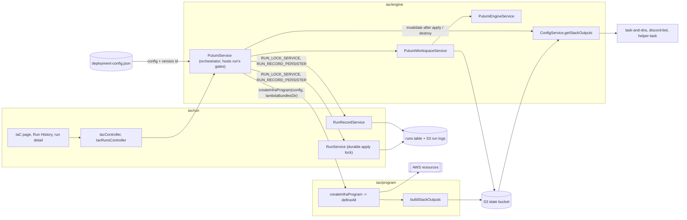

# High-Level Design: IaC

This is the sub-HLD for the `iac` grouping node: everything that turns the operator's declared setup into real AWS resources, safely and with a record of every attempt.
It owns no EARS; its three leaf children (`iac/run`, `iac/engine`, `iac/program`) own the specs under the `IAC-RUN`, `IAC-ENGINE` and `IAC-PROGRAM` prefixes, and `grep IAC-` gathers the whole subtree.
This document holds what spans the children: the problem they solve together, how they divide it, the contracts between them, the decisions whose substance crosses more than one leaf, and the subtree's dependencies on the rest of the tree.
Rationale is marked `[stated]` when the cited source gives it and `[inferred]` when it is a reading of the code or designs that no source states.

## Problem

Hyveon's whole AWS footprint (network, ECS cluster and task definitions, Lambdas, tables, secrets, the Discord domain) has to exist before a game can be started, and has to change whenever the operator adds, edits or removes a game.
The operator works only through a packaged desktop app, so provisioning cannot assume a host-installed `pulumi` binary, a CLI-based IaC step or any other tooling on the operator's machine (`CLAUDE.md`, "Commands"; `docs/docs/architecture.md`, "Why Pulumi").
Changing live infrastructure is the most destructive thing the app does: an unreviewed apply can replace or delete resources, two concurrent mutations of one stack can corrupt it, and a crashed operation can leave the state backend locked (`run-design.md`, intro; `engine-design.md`, "Operation Execution").
The operator also needs to know afterwards what was attempted, who approved it, what it changed and how it ended, and to be able to roll a bad change back (`run-design.md`, intro and "Rollback flow").

## Approach

The subtree splits the problem along three seams, one per child.

### A declared program: `iac/program`

One inline Pulumi Automation API program in `@hyveon/infra`, `createInfraProgram(config, options)`, turns a single `DeploymentConfig` into the full resource graph and hands back typed `StackOutputs` (`program-design.md`, "Context and Design Philosophy").
Every per-game resource fans out from `config.gameServers`, so a game is one map entry and nothing is per-game hand-written (`CLAUDE.md`, "Invariants that hurt to break"; `docs/docs/components/infra.md`, "Configuration input").

### An embedded engine: `iac/engine`

The app provisions its own exact-pinned Pulumi CLI into `userData`, opens one stable workspace against the operator's own S3 state bucket with a derived passphrase, injects the wizard-selected AWS credentials exclusively, runs preview, up and destroy under cancellation and leaked-promise recovery (stack initialization's `refresh()` runs without either wrapper), reclaims a stale backend lock only when it can prove the lock is its own orphan, and serves the deployed stack outputs to the rest of the app through a memoised reader (`engine-design.md`, "Context and Design Philosophy").

### A gated, recorded run: `iac/run`

Every preview, up and destroy the operator starts is a *run*: a `runId`, a durable `RunRecord` in the runs table, a captured log and, for apply and destroy, a durable apply lock (`run-design.md`, intro).
Apply is reachable only through plan, approval and a plan-hash-gated apply; destroy needs a server-minted single-use token; rollback restores an earlier configuration as a new head and then plans it through the same gates (`run-design.md`, "Decisions & Alternatives").

## Target Users

The operator, who reviews a plan, approves it, applies it, destroys the stack or rolls back from the IaC, Run History and run-detail pages, and who meets the engine first as the wizard's final stack-initialization step (`run-design.md`, intro; `engine-design.md`, "Stack Initialization and Stack Outputs").
The maintainer, who changes the program when a `DeploymentConfig` field changes what gets provisioned (`CLAUDE.md`, "Before opening a PR", deployment-config fields).
Players never interact with this subtree directly; they consume what it provisions.

## Goals

*(not yet specified)*

The node purpose recorded in the root HLD's node table ("turning the operator's declared setup into real AWS resources, safely and with a record of every attempt") is the only stated aim; no falsifiable goals are stated for the subtree.

## Non-Goals

Each of these is stated in a grounding source as a boundary the subtree does not cross:

- No host-installed `pulumi` binary and no CLI-based IaC step (`CLAUDE.md`, "Commands").
- No Pulumi Cloud account or access token; state lives in a DIY S3 backend (`engine-design.md`, "Decisions & Alternatives", state backend).
- No persistent ECS Service; the program declares task definitions only (`CLAUDE.md`, invariants; `program-design.md`, invariants table).
- No Pulumi-managed per-game DNS record; `route53.ts` is a hosted-zone lookup (`CLAUDE.md`, invariants).
- No ALB, target group or ACM certificate for games (`CLAUDE.md`, invariants); the Discord domain's certificate is an open carve-out question, see Open Questions.
- No real secret material as a program input or in stack state (`program-design.md`, "Decisions & Alternatives", secret material).
- No runs table inside the stack; it is created at bootstrap (`docs/docs/components/infra.md`, "The runs table invariant").

## Tenets

Hyveon's root tenets (`docs/high-level-design.md`, "Tenets") apply to this subtree unchanged. Subtree-specific tenets are not yet specified.

Candidate subtree tenets the children surface, for the user to confirm or reject:

- "History must never fail a good run, but the marker that blocks blind retries must never be skipped" (`run-design.md`, persistence failure policy).
- "Never reclaim a lock without proof that it is our own dead orphan" (`engine-design.md`, lock reclaim; `IAC-ENGINE-LOCK-*`).
- "A UI check is defence in depth, never the only barrier" (`run-design.md`, destroy confirmation, citing `add-terraform-run-ui/design.md`, Decision 8).

## System Design

### Node table

| Node | Kind | Purpose | Design doc | Specs | Prefix |
|---|---|---|---|---|---|
| `iac` | sub-HLD | Declared setup to real AWS resources, safely, with a record of every attempt. | `docs/intent/iac/iac-design.md` | none (owns no EARS) | `IAC` |
| `iac/run` | leaf | Each plan / apply / destroy / rollback attempt as a durable record; apply lock; IaC, history and run-detail pages. | [`run/run-design.md`](run/run-design.md) | [`run/run-specs.md`](run/run-specs.md) | `IAC-RUN` |
| `iac/engine` | leaf | Pulumi inside the app: pinned engine, workspace, backend, credentials, cancellation, backend-lock recovery, stack init, cached outputs. | [`engine/engine-design.md`](engine/engine-design.md) | [`engine/engine-specs.md`](engine/engine-specs.md) | `IAC-ENGINE` |
| `iac/program` | leaf | The inline program describing every AWS resource, the Lambda env wire format, and the `StackOutputs` it returns. | [`program/program-design.md`](program/program-design.md) | [`program/program-specs.md`](program/program-specs.md) | `IAC-PROGRAM` |

Arrow docs: `docs/arrows/iac/run.md`, `docs/arrows/iac/engine.md`, `docs/arrows/iac/program.md`.

### How the children fit

Sources: `run-design.md` ("Run Record and Storage", "Apply Lock"), `docs/arrows/iac/run.md` (component 7, `run-record.module.ts` aliases), `engine-design.md` ("Stack Initialization and Stack Outputs"), `program-design.md` ("Composition and Dependency Order"), `docs/docs/components/infra.md` ("How it's invoked", "Configuration input").

### Contracts between the children

| Contract | Owner of the intent | Other party | What crosses |
|---|---|---|---|
| Inline program | `iac/program` (`createInfraProgram`, `IAC-PROGRAM-WS-*`) | `iac/engine` calls it from `PulumiService` for preview and up | A `PulumiFn` built from the fetched `DeploymentConfig` plus the machine-local `lambdaBundlesDir`, which `PulumiService` resolves (`program-design.md`, "Composition and Dependency Order"). Destroy and stack init pass a no-op program instead (`docs/docs/components/infra.md`, "How it's invoked"; `IAC-ENGINE-INIT-001`). |
| Stack outputs shape | `iac/program` (`shared/src/stackOutputs.ts`, `IAC-PROGRAM-OUT-*`) | `iac/engine` projects and caches it | Every `StackOutputs` field, with a compile-time check that the program returns each one (`program-design.md`, "Stack Outputs and Create-Only State"). |
| Stack outputs read path | `iac/engine` (`IAC-ENGINE-OUT-*`) | `iac/run` and consumers outside the subtree | A never-throwing read where `null` means "not deployed", memoised by `ConfigService` and invalidated only after a successful apply or destroy (`engine-design.md`, "Stack Initialization and Stack Outputs"). |
| Gate guarantees | `iac/run` (`IAC-RUN-GATE-*`, `IAC-RUN-PART-*`, `IAC-RUN-DSTR-*`, `IAC-RUN-RBK-*`) | Implemented in engine-owned `PulumiService.ts` | The 8-step apply gate, pre-flight marker and partial-apply detection, destroy token and rollback restore-then-plan; `iac/run` says what a run is guaranteed, `iac/engine` says how Pulumi is driven (`run-design.md`, "What it deliberately does not own"). |
| Run records and the apply lock | `iac/run` (`IAC-RUN-REC-*`, `IAC-RUN-STORE-*`, `IAC-RUN-LOCK-*`) | `PulumiService` writes local `run.json`, calls `RunService.createRun` and `RunRecordService.persist` / `writePreflightMarker` through the `RUN_LOCK_SERVICE` / `RUN_RECORD_PERSISTER` aliases | A record per settled run, a fail-closed marker before `stack.up()`, and lock acquisition as the final gate step (`run-design.md`, "Persistence semantics", "Apply Lock"). |
| Engine version | `iac/engine` (`IAC-ENGINE-PIN-*`) | `iac/run` records it on every plan and compares it at apply | `resolvedVersion` of the pinned engine; a changed engine refuses the apply (`IAC-RUN-GATE-010`). |
| In-process exclusivity | `iac/engine` (`operationInFlight`, `IAC-ENGINE-LOCK-009`) | `iac/run`'s controllers read it for the busy refusal | `getOperationInFlight()`; the durable apply lock is taken first and the workspace guard checked after (`IAC-RUN-GATE-013`). |
| Backend lock recovery | `iac/engine` (`IAC-ENGINE-LOCK-*`) | `iac/run`'s controller carries the `staleLock` ack and the `iac.lock.clear` channels | `PulumiUnrecognizedLockError` with holder and age, then an operator-confirmed clear (`engine-design.md`, "Lock recovery"; `run-design.md`, "IPC surface"). `iac/run` owns the confirmed clear's specs (`IAC-RUN-LCLR-009` to `IAC-RUN-LCLR-012`). |
| Lambda env wire format | `iac/program` (`IAC-PROGRAM-ENV-*`) | Lambda handlers in other subtrees parse it with `@hyveon/shared/env` | JSON maps and CSV baked into each function's env with `AWS_REGION_` (`program-design.md`, "Lambda Wiring and Environment Contract"). |

### Three kinds of exclusion

Three distinct guards keep two operations off one stack, and they are owned by different children (`docs/docs/components/infra.md`, "State backend", final bullet; `run-design.md`, "Apply Lock"; `engine-design.md`, "In-process exclusivity").

| Guard | Owner | Scope | Taken by |
|---|---|---|---|
| Pulumi DIY backend lock object in the state bucket | `iac/engine` (Pulumi itself; recovery in `PulumiLockRecovery.ts`) | Any engine call that can take the lock, from any machine | `up`, `destroy`, stack-init `refresh` |
| Durable apply lock, `LOCK/CURRENT` in the runs table, mirrored in memory | `iac/run` (`RunService`) | All app instances against one runs table, 1 h TTL | apply and destroy |
| `operationInFlight` / `stackInitInFlight` | `iac/engine` (`PulumiService`) | One app instance | preview, up, destroy, rollback, stack init |

### Cross-subtree dependencies

| Neighbour | Direction | What crosses | Source |
|---|---|---|---|
| `deployment-config` | upstream | `PulumiService` fetches `deployment-config.json` and its version id; the version id enters `planHash` and the stale-config gate; rollback uses `restoreRawConfig` and version listing; the program trusts the read-time normaliser (for example `webPort`). | `docs/docs/components/infra.md`, "Configuration input"; `run-design.md`, "What it deliberately does not own"; `program-design.md`, "What it deliberately does not own" |
| `game-server` | upstream | `GameServerConfig`, `ingressPorts`, the env-token catalogue the program fans out from. | `program-design.md`, "What it deliberately does not own"; `docs/arrows/iac/program.md`, "Cited from other leaves" |
| `operator-app/wizard-and-bootstrap` | upstream | Credential custody behind `PulumiCredentialResolver`; bootstrap creates the state bucket, configuration bucket and runs table; the wizard's final step is `iac.stack.initialize`. | `engine-design.md`, intro; `docs/docs/components/infra.md`, "The runs table invariant" |
| `operator-app/ipc-bridge`, `operator-app/desktop-shell` | upstream | `window.hyveon.iac.*` and the self-bridged streaming channels; binding of `RUN_RECORD_STORE` with its pre-apply table-name fallback. | `run-design.md`, "What it deliberately does not own" |
| `game-runtime/task-and-dns` | downstream | Cluster, subnets and security group from stack outputs, and the install region from `ConfigService.getRegion()` (decision 11); the update-dns Lambda and its EventBridge rule are declared by the program. | `docs/arrows/index.yaml` (`engine` and `program` block `task-and-dns`); `program-design.md`, Lambda table |
| `game-runtime/watchdog`, `game-runtime/health-check` | downstream | Function, role, schedule, security group and baked env (`IDLE_CHECKS`, `HEALTH_CHECKS`, `HEALTH_CHECK_FUNCTION_NAME`). | `program-design.md`, "Lambda Wiring and Environment Contract" |
| `discord-bot` | downstream | Interactions and followup functions, Function URL behind `discord.{zone}`, Discord table, secret ARNs, seed rows; `discordInteractionsUrl` output. | `program-design.md`, "Resource Areas", "Stack Outputs and Create-Only State" |
| `helper-task` | downstream | `efsVolumeAccessPoints`, file-manager security group, FileBrowser scheduler role and log group; per-game efs-seeder invoked during apply. | `program-design.md`, "Stack Outputs and Create-Only State"; `docs/arrows/iac/program.md`, "Cited from other leaves" |
| `operator-app/infra-logs` | downstream | The game and Lambda log groups the program declares, `/ecs/{game}-server` and `/aws/lambda/{projectName}-{functionKey}`. `infra-logs` resolves both names deterministically from the game name and the configured `projectName`, never through stack outputs. | `docs/arrows/index.yaml` (`program` blocks `infra-logs`); `infra-logs-design.md`, "Context and Design Philosophy" |

## Key Design Decisions

Each decision below is recorded here because its substance crosses at least two children; leaf-only decisions stay in the leaf's Decisions & Alternatives table.

1. **Pulumi Automation API, driven in-process, with an inline program and an app-provisioned exact-pinned engine.**
   Spans `iac/engine` (engine source, version policy, program form) and `iac/program` (IaC tool, program form).
   Rationale `[stated]`: multi-cloud optionality, no HCL round-trip because program and app share TypeScript types, and no operator-installed binary (`docs/docs/architecture.md`, "Why Pulumi"); a `workDir` program is hostile to asar and would put editable infra source on disk (`program-design.md` and `engine-design.md`, "Program form", citing `migrate-iac-to-pulumi/design.md`).
   Alternatives rejected `[stated]`: CDK for Terraform, AWS CDK and auto-downloaded OpenTofu with HCL; a host-installed `pulumi` on `PATH`; a `workDir` project with `Pulumi.yaml` (`program-design.md`, `engine-design.md`, Decisions & Alternatives).

2. **Review before mutate: plan, approve, then a plan-hash-gated apply, enforced server-side.**
   Spans `iac/run` (gate guarantees, approval, the IaC page) and `iac/engine` (where the gate code runs, the saved update plan, the resolved engine version).
   Rationale `[stated]`: an apply executes exactly the plan that was approved, against the configuration and engine version it was planned with, inside a 15-minute approval window, and the approver is the local OS username resolved server-side so an IPC caller cannot spoof it (`run-design.md`, approver identity; `IAC-RUN-GATE-002` to `IAC-RUN-GATE-010`).
   Alternatives rejected: apply without a reviewed preview `[inferred]`; caller-supplied approver identity `[stated]` (`run-design.md`).

3. **Three separate exclusion guards, with the durable apply lock as the final authoritative gate step.**
   Spans `iac/run` (durable apply lock) and `iac/engine` (backend lock recovery, in-process guard).
   Rationale `[stated]`: the in-memory lock gives race-free same-process exclusion without a mutex and the DynamoDB item adds restart durability and multi-process safety (`run-design.md`, two-layer apply lock); the backend lock is Pulumi's own and is a distinct concept from the app's submission lock (`docs/docs/components/infra.md`, "State backend"); auto-reclaim on identity alone would reclaim a live sibling's lock (`engine-design.md`, lock reclaim).
   Alternatives rejected `[stated]`: in-memory only or DynamoDB only; identity-only reclaim; always asking the operator (`run-design.md`, `engine-design.md`).

4. **The runs table and run records live outside the stack.**
   Spans `iac/program` (does not declare the table; echoes its name as `runsTableName`), `iac/run` (writes and reads it, with a pre-apply name fallback) and, across the subtree boundary, `wizard-and-bootstrap` (creates it).
   Rationale `[stated]`: the approve and apply gates need the table on the very first plan/apply cycle, before any apply has succeeded, and a stack only reports outputs after its first successful apply (`docs/docs/components/infra.md`, "The runs table invariant"; `program-design.md`, runs table).
   One name function, `resolveRunsTableName`, is called from bootstrap, `buildStackOutputs` and the pre-apply fallback so the three never disagree (`docs/docs/components/infra.md`, same section).
   Intended behaviour: before the first successful apply, every `iac/run` reader of the table resolves its name through that pre-apply fallback, `RunRecordService` for run records and `RunService` for the durable apply lock, so the first apply on a fresh install holds the durable lock like every later apply (`IAC-RUN-LOCK-009`).
   Current gap: only `RunRecordService` uses the fallback; when stack outputs lack `runsTableName`, `RunService` skips the durable store, so the first apply on a fresh install is guarded by the in-memory lock alone (`run-design.md`, "Fresh-install gap").
   Alternative rejected `[stated]`: a Pulumi-managed table (`program-design.md`).

5. **Stack outputs are the only channel by which the rest of the app discovers what was deployed.**
   Spans `iac/program` (the typed `StackOutputs` contract and its completeness check) and `iac/engine` (the never-throwing, memoised read path and its invalidation).
   Rationale: the backend reads the deployed stack's outputs from the S3 state backend with no local state file (`docs/docs/architecture.md`, intro) `[stated]`; every call site relies on `null` meaning "not deployed" (`engine-design.md`, outputs read path) `[stated]`; caching avoids an engine call per poll `[inferred]`.
   Alternatives rejected: throwing to callers, or reading uncached (`engine-design.md`) `[inferred]`; discovering resources by querying AWS by tag `[inferred]`, no source evidences it was considered.

6. **Destroy and stack initialization run a no-op program.**
   Spans `iac/engine` (stack init with an inert program, destroy orchestration) and `iac/program` (the real program is used only for preview and up).
   Rationale `[stated]`: tearing down a stack must never require reading, or be blocked by, a broken configuration object (`docs/docs/components/infra.md`, "How it's invoked").
   Alternative rejected `[inferred]`: destroy with the full program built from the current configuration.

7. **Secrets stay out of the stack, and the stack passphrase is not a confidentiality boundary.**
   Spans `iac/program` (placeholder secret versions with `ignoreChanges`, no `pulumi.secret` anywhere) and `iac/engine` (a passphrase derived from account id and stack name, never stored).
   Rationale `[stated]`: removing secrets as program inputs closes the one route by which a real token could reach state (`program-design.md`, secret material); because nothing sensitive is gated behind the passphrase, deriving it from values anyone with account read access can see is safe, and it makes the stack portable across machines on the same account (`docs/docs/components/infra.md`, "State backend"; `engine-design.md`, passphrase source).
   Alternatives rejected `[stated]`: Discord secrets as program inputs; a random per-machine passphrase in `safeStorage`; a customer-managed KMS key (`program-design.md`, `engine-design.md`).

8. **Game environment values are echoed into outputs unencrypted and redacted from engine output by the app.**
   Spans `iac/program` (`appliedGameServers` is not `pulumi.secret`, so consumers redact) and `iac/engine` (`redactEnvironmentValues` on streamed lines).
   Rationale `[stated]`: the program leaves redaction to consumers (`program-design.md`, outputs table, citing `program.ts:11-15`); `PulumiService` replaces every value of four or more characters from the current configuration before a line reaches the run-log viewer or `pulumi.log` (`docs/docs/components/infra.md`, "Configuration input").
   Alternative rejected `[inferred]`: marking the output `pulumi.secret`, which would make the passphrase a confidentiality boundary and contradict decision 7.
   Destroy output is not yet redacted (`IAC-ENGINE-REDACT-002`); `iac/engine` owns redaction for every operation.

9. **Portable configuration, machine-local inputs.**
   Spans `iac/program` (requires `lambdaBundlesDir` as an option with no default) and `iac/engine` (resolves it, and resolves engine and workspace paths under `userData`).
   Rationale `[stated]`: `DeploymentConfig` is portable across machines and a filesystem path is not; a repo-relative default resolves inside a checkout but not inside the electron-vite bundle (`program-design.md`, "Composition and Dependency Order").
   Alternative rejected `[stated]`: an `import.meta.url`-relative default (`program-design.md`).

10. **`PulumiService.ts` splits along the run/engine seam.**
    Spans `iac/run` and `iac/engine`.
    `iac/run`'s gate logic (run gates, locking, run lifecycle) sits in engine-owned `PulumiService.ts` (about 5,000 lines) beside `iac/engine`'s workspace, backend, credential and engine plumbing; this co-location is the real mutual dependency recorded between `run` and `engine` in `docs/arrows/index.yaml`.
    Spec ownership follows behaviour, not file: `iac/run` specifies what the gates guarantee, `iac/engine` specifies how Pulumi is driven (`run-design.md`, "What it deliberately does not own"; `engine-design.md`, intro).
    The intended structure separates the two along that same seam into separate files, as a pure refactor with no behaviour change, carried out as its own change. The `run` <-> `engine` cycle stays recorded in `index.yaml` until that refactor lands (`docs/arrows/iac/engine.md`, Work Required).
    Rationale: the gates need the workspace, the saved update plan, the resolved engine version and the in-process guard, all of which `PulumiService` holds, which explains the co-location `[inferred]`; separating the files removes the `run` <-> `engine` cycle and makes file ownership match spec ownership.
    Alternative rejected: keeping one file (`engine-design.md`, Decisions & Alternatives).

11. **One AWS region per install: the wizard region drives the backend, the program and every client.**
    Spans `iac/engine` (the backend URL, the program's `awsRegion` input and the `ConfigService.getRegion()` resolver) and `iac/program` (every regional resource declared against one provider for `config.awsRegion`).
    The state backend URL uses the wizard's `aws.region`, the bucket's own region because bootstrap creates it there (`IAC-ENGINE-WS-010`); `PulumiService` sets the program's `awsRegion` input from `ConfigService.getRegion()` and ignores any stored `DeploymentConfig.awsRegion` (`IAC-ENGINE-REGION-001`); stack outputs echo that region, and no desktop client reads its region from them (`IAC-ENGINE-REGION-002`). The program's `us-east-1` provider for the CloudFront certificate is an AWS-mandated placement outside the rule (`program-design.md`, "Composition and Dependency Order", step 1).
    Rationale `[stated]`: changing the region replaces the whole stack, EFS world saves included, so the region is chosen once in the wizard and moving it is a deliberate destroy-and-rebuild (`docs/high-level-design.md`, decision 10).
    Alternative rejected `[stated]`: a control-plane region and a separate game region (`engine-design.md`, Decisions & Alternatives, "Install region").

## Success Metrics

*(not yet specified)*

## Open Questions

Questions whose answer crosses more than one child, or where the children's designs disagree or admit two readings.
Leaf-only questions stay in each leaf's Open Questions.

1. **Is a mid-operation `null` from the outputs reader acceptable at the subtree boundary?** While any operation is in flight `getStackOutputs` returns `null`, which `ConfigService` caches for 20 s, so every downstream consumer reads "not deployed" during and just after a run (`engine-design.md`, Deferred 13). The answer is a contract with `task-and-dns`, `discord-bot` and `helper-task`, not only an engine detail.
2. **Who corrects the stale "machine-bound" passphrase sentence in `openspec/specs/pulumi-infra-program/spec.md:70`?** `engine-design.md` Deferred 5 asks for an owner; `program-design.md` Deferred 18 says the fix is owned by `iac/engine`. The two readings should be reconciled to one owner.
3. **Does the "no ACM certificate" invariant need a Discord-domain carve-out?** The program declares an ACM certificate for `discord.{zone}` (`program-design.md`, Deferred 5), which the CLAUDE.md wording does not allow for.

## References

- Child designs: `docs/intent/iac/run/run-design.md`, `docs/intent/iac/engine/engine-design.md`, `docs/intent/iac/program/program-design.md`
- Child specs: `docs/intent/iac/run/run-specs.md`, `docs/intent/iac/engine/engine-specs.md`, `docs/intent/iac/program/program-specs.md`
- Arrow docs: `docs/arrows/iac/run.md`, `docs/arrows/iac/engine.md`, `docs/arrows/iac/program.md`; `docs/arrows/index.yaml` (`iac`, `run`, `engine`, `program` entries)
- Parent: `docs/high-level-design.md`
- Project docs: `docs/docs/architecture.md`, `docs/docs/components/infra.md`, `docs/docs/app/iac.md`, `CLAUDE.md` ("Invariants that hurt to break")
- OpenSpec design history: `openspec/changes/archive/2026-08-10-migrate-iac-to-pulumi/design.md`, `openspec/changes/archive/2026-07-26-add-terraform-run-ui/design.md`, `openspec/changes/archive/2026-08-10-add-run-lock-recovery/design.md`, `openspec/changes/archive/2026-08-13-pulumi-portable-passphrase/design.md`
