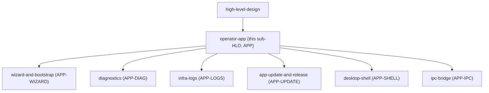
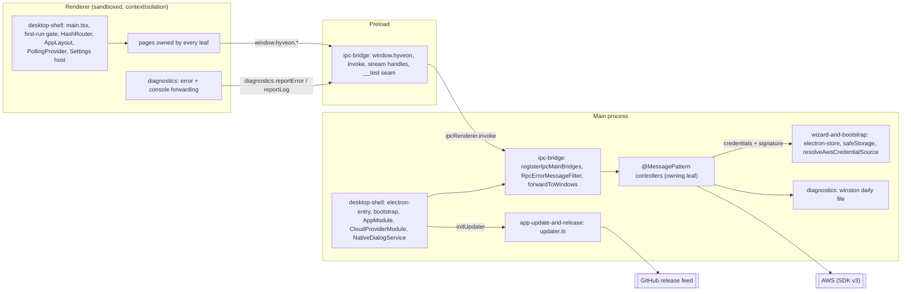

# High-Level Design: Operator App

This is the sub-HLD for the `operator-app` grouping node: the packaged Electron desktop app itself, and the operator jobs that concern the app or the AWS account rather than any one game.
It owns no EARS; its six child leaves own the `APP-*` specs listed in the node table.
It is grounded in the six child design docs under `docs/intent/operator-app/`, their arrow docs under `docs/arrows/operator-app/`, `docs/docs/components/management-app.md`, `docs/docs/app/`, `docs/docs/architecture.md` and the `CLAUDE.md` invariants.
Rationale is marked `[stated]` when a cited source gives it and `[inferred]` when it is this document's reading; sections no source speaks to are marked `*(not yet specified)*`.

## Problem

Every other part of Hyveon needs a place for the operator to act from: provisioning runs, game definitions, start and stop, Discord credentials, volume files and costs all need a surface, and the project has no web console and no API server to host one (`desktop-shell-design.md`, Context; `CLAUDE.md`, "The desktop app has no HTTP transport").
That surface also has jobs of its own that belong to no game:

- A fresh install has no AWS account wired to it, no Pulumi state bucket, no configuration bucket, no `deployment-config.json` and no runs table, and nothing else in the app can work until all of those exist (`wizard-and-bootstrap-design.md`, Context).
- With no HTTP cycle and no server to log into, the winston log file is the only record of what the app did once an operator reports "it hung" (`.claude/rules/logging.md`, "Why"; `diagnostics-design.md`, Context).
- Without an in-app viewer, reading a game's or a Lambda's CloudWatch logs means leaving the app for the AWS Console (`infra-logs-design.md`, Context).
- The app ships as one installer per OS, so new versions have to be cut, published and offered to operators without either end happening unattended (`app-update-and-release-design.md`, Context).

Who suffers most and why now are not stated for this subtree: *(not yet specified)*.

## Approach

### One window, one container, one bridge

The app is a single sandboxed Electron `BrowserWindow` running a React/Vite renderer, backed by a Nest.js container running as an Electron IPC microservice in the main process (`docs/docs/components/management-app.md`, "`@hyveon/desktop-main`").
The renderer reaches the back end only by calling methods on `window.hyveon`, which the preload script turns into `ipcRenderer.invoke` calls that a generic bridge dispatches to `@MessagePattern` handlers (`ipc-bridge-design.md`, "Call Path").
Every page in the app, whichever leaf owns it, goes through that one bridge.

### Main-process custody of AWS access

Every AWS SDK call runs in `desktop-main`; the renderer is lint-banned from importing `@aws-sdk/*` (`wizard-and-bootstrap-design.md`, "Main-process SDK only").
The first-run wizard turns an empty install into a credentialed, bootstrapped account, and the credentials it stores are resolved through one function by every AWS caller in the app (`wizard-and-bootstrap-design.md`, "Credential Custody").

### Account- and app-level operator jobs as leaves

The jobs above that concern no single game each get a leaf: first-run and Reconfigure (`wizard-and-bootstrap`), the app's own log, support bundle and audit trail (`diagnostics`), CloudWatch log reading (`infra-logs`), and the release pipeline plus in-app updater (`app-update-and-release`).
The two remaining leaves are the app's skeleton: the window, composition root and routed shell (`desktop-shell`), and the channel between renderer and main process (`ipc-bridge`).

## Target Users

- **The operator**, who installs the packaged app, runs the first-run wizard against their own AWS account and then drives everything from the window (`docs/docs/app/index.md`, intro; `README.md`, "Documentation" via the root HLD).
- **Whoever receives a support bundle**, which is built to be safe to hand to someone else (`diagnostics-design.md`, Context).
- **The maintainer**, who cuts releases through a manually dispatched workflow and publishes the resulting draft (`app-update-and-release-design.md`, "Release Production Pipeline").

Players are not users of this subtree; they reach games through Discord (`discord-bot`) and directly at the task's address.
Needs and acceptable cost per role are not stated: *(not yet specified)*.

## Goals

*(not yet specified)*

Each child states its own purpose in its Context section; no source states falsifiable outcomes for the subtree as a whole.

## Non-Goals

These are stated as prohibitions or explicit non-goals in the cited sources and bound the whole subtree:

- No HTTP server, listen port, bearer token or API base URL in the desktop app (`CLAUDE.md`, "The desktop app has no HTTP transport"; `docs/docs/components/management-app.md`, "Auth").
- No web console; the operator surface is the one Electron window (`desktop-shell-design.md`, Context).
- No secret values in the renderer; Discord and health-check secrets cross only as `botTokenSet` / `publicKeySet` / `secretSet` style booleans, and no channel returns a helper credential (`CLAUDE.md`, "Secrets never reach the renderer"; `ipc-bridge-design.md`, "Contract and Types").
- No AWS SDK in the renderer (`app/eslint.config.js:114-198`, cited by `wizard-and-bootstrap-design.md`).
- No update that downloads or installs itself, and no update-feed request at boot unless the operator opted in (`app-update-and-release-design.md`, guiding principles).
- No per-workspace versioning; only the root version is released (`app-update-and-release-design.md`, Decisions, citing the `add-release-automation` design's Non-Goals).
- No server-side log search in the log viewer (`infra-logs-design.md`, Decisions, citing the archived `add-infra-log-viewer` design's Non-Goals).

## Tenets

Hyveon's root tenets (`docs/high-level-design.md`, "Tenets") apply to this subtree unchanged. Subtree-specific tenets are not yet specified.

Candidate subtree tenets the children surface, for the user to confirm or reject: "never persist a secret in plaintext" (`wizard-and-bootstrap-design.md`), "new fields are excluded by default" for anything leaving the machine (`diagnostics-design.md`, config allowlist decision), and "a failed IPC call must never lock a working install out of its dashboard" (`desktop-shell-design.md`, first-run gate).

## System Design

### Design subtree

### Runtime layers

The app is three Electron contexts plus the outside services it talks to.
Each box names the child that owns it; controllers belong to the leaf whose behaviour they serve, inside or outside this subtree (`ipc-bridge-design.md`, "What it deliberately does not own").

### How the six children divide the app

| Child | Layer | Owns | Deliberately leaves to others |
|---|---|---|---|
| `desktop-shell` | main + renderer | Electron entry, `bootstrap()`, `AppModule` and `CloudProviderModule`, `NativeDialogService`, window chrome and `WindowController`, first-run gate, route table and sidebar, top bar, `PollingProvider`, Settings host page, shared UI primitives and tokens, icon pipeline (`desktop-shell-design.md`, Context) | The transport, the wizard component, renderer error reporting, the updater, and every Settings section's content |
| `ipc-bridge` | preload + main dispatch | `HyveonApi` and `Window.hyveon`, preload `invoke` / `subscribe` / buffered streams, `registerIpcMainBridges`, `SELF_BRIDGED_PATTERNS`, `RpcErrorMessageFilter`, payload guards, `forwardToWindows`, the `__test` seam and secret-shape test helpers (`ipc-bridge-design.md`, Context) | Bootstrapping and the window, and every handler |
| `wizard-and-bootstrap` | renderer + main | Five-step first-run wizard and Reconfigure, guided IAM, SDK-direct bootstrap of buckets, seed config and runs table, IAM check, Cloud Health, and credential custody (`wizard-and-bootstrap-design.md`, Context) | The final stack-init step (`iac/engine`), the first-run gate and Settings host (`desktop-shell`), the preload facade (`ipc-bridge`) |
| `diagnostics` | renderer + main + AWS | Winston singleton and daily file, tail reads, renderer crash and console forwarding, Settings → Diagnostics panel, support bundle export, audit trail and `/audit` page (`diagnostics-design.md`, Context) | Logger bootstrap, log-line rendering (`infra-logs`), CloudWatch logs, the audit table and its callers |
| `infra-logs` | renderer + main + AWS | `LogsService`, `LogsController`, `LambdaFunctionKey`, `useLogTail`, `LogTailView`, `/logs` and `/logs/infrastructure`, the shared `LogLineList` and ANSI parser (`infra-logs-design.md`, Context) | The game live-tail loop (`game-runtime/task-and-dns`), the log groups (`iac/program`), `projectName` (`deployment-config`) |
| `app-update-and-release` | CI + main | `release.yml` and its composite actions, `cliff.toml`, `electron-builder.yml` feed metadata and runtime closure, `updater.ts` and `updater-fallback.ts`, the auto-update channel contract (`app-update-and-release-design.md`, Context) | The Settings page file (it specifies the Updates rows' behaviour), the bridge, `iac-settings.controller.ts` (`deployment-config`'s, which hosts the auto-update channels until they move to a controller this leaf owns; see decision 9), the electron-store schema, the boot call |

### Contracts between the children

**The `window.hyveon` bridge.**
Every renderer page calls `window.hyveon.<namespace>.<action>`, and every write method passes one payload object because the transport delivers only the first argument to `@Payload` (`ipc-bridge-design.md`, "Call Path").
A leaf adding a channel adds a `@MessagePattern` handler in its own controller, registers the controller in `desktop-shell`'s `AppModule`, and adds the method to `ipc-bridge`'s hand-written `HyveonApi` and preload object; the channel string is the only checked link, guarded per controller by `expectChannels` (`ipc-bridge-design.md`, "Contract and Types"; `desktop-shell-design.md`, "Root module").
Nine namespaces are wrapped by the `api.*` facade in `web/src/api.service.ts`; the rest of the renderer calls `window.hyveon` directly (`ipc-bridge-design.md`, "Renderer facades"; see Open Questions 1).

**Error flattening.**
On generic-bridge channels, whatever a handler throws reaches the renderer as a plain `Error` carrying only `.message`, via the global `RpcErrorMessageFilter` and the bridge's catch-log-rethrow (`ipc-bridge-design.md`, "Error Path").
Self-bridged channels bypass both normalisers, so their owning leaves (`infra-logs`, `iac/run`, and the auto-update download) carry that duty themselves today (`ipc-bridge-design.md`, "Where current behaviour differs").
The owning leaf's side of the contract is `.claude/rules/logging.md` rule 2: catch SDK failures in the service, log the normalised message, and return a modeled result or throw a plain `Error`.

**Stream handles.**
A streaming channel is a preload-internal generator wrapped in a plain `HyveonStreamHandle` (`next`, `cancel`, `[Symbol.asyncIterator]`) because neither an `AsyncGenerator` nor a renderer `AbortSignal` survives the context bridge (`ipc-bridge-design.md`, "Streaming Across the Context Bridge").
Two styles exist: per-call channels whose cancel reaches main, used by `infra-logs`' `logs.stream` and `logs.lambda.stream`; and fixed shared channels filtered by `streamId`, used by `iac/run`'s `iac.stack.initialize` and `iac.runs.logs` and by `app-update-and-release`'s `iac.settings.autoUpdate.download`.
A leaf owning a streaming channel registers its own `ipcMain.handle` behind a `process.versions.electron` guard and must appear in `ipc-bridge`'s hand-synced `SELF_BRIDGED_PATTERNS` list (`ipc-bridge-design.md`, "Self-bridged channels").

**Main-to-renderer pushes.**
`window.maximizedChange` (`desktop-shell`), `folderUpload.progress` and the two `volumeFiles` pushes (`helper-task`) travel over `webContents.send` and arrive through the preload `subscribe` helper, which returns a clone-safe unsubscribe function (`ipc-bridge-design.md`, "Push channels"; `desktop-shell-design.md`, "Window IPC").

**Logging and diagnostics duties.**
`desktop-shell` creates the winston logger under `<userData>/logs` before the Nest container boots, and `diagnostics` owns the logger and its file (`desktop-shell-design.md`, "Process Start"; `diagnostics-design.md`, "The App Log").
Every controller in any leaf logs `logger.debug('<ControllerName>: <pattern> invoked')` as its first line with identifiers only, and every failing service method logs and normalises (`.claude/rules/logging.md`; `docs/docs/components/management-app.md`, "Logging").
Each leaf restates the entry-log rule for its own controllers in its specs (for example `APP-DIAG-SVC-005` and `IAC-RUN-IPC-002`), while the service-layer rule is held under `APP-DIAG-SVC` (see Open Questions 4).
`desktop-shell`'s `main.tsx` installs `diagnostics`' global error reporting, console forwarding and `ErrorBoundary`, so renderer failures land in the same file as main-process lines (`diagnostics-design.md`, "Renderer Error and Console Forwarding").

**Credentials and bootstrap state, from the wizard into the rest.**
The wizard writes `activeCloud`, `aws.profile`, `aws.region` and `bootstrap` bucket names to electron-store and, for pasted and guided keys, an OS-keychain-encrypted `creds.aws[<profile>]` entry (`wizard-and-bootstrap-design.md`, "Where state lives").
Every AWS caller in the app resolves credentials through `resolveAwsCredentialSource` and caches clients on `<region>::<signature>`, so a same-region key change takes effect without a restart (`wizard-and-bootstrap-design.md`, "Resolution").
`desktop-shell`'s `CloudProviderModule` hands each store a lazy resolver rather than a resolved config, so the container builds on a fresh install before any credentials or stack outputs exist (`desktop-shell-design.md`, "Cloud provider bindings").
The wizard's bootstrap step also seeds `deployment-config.json` and creates the runs table, then hands off to `iac/engine`'s stack-init step; `wizard.complete` sets the `wizardCompleted` flag that `desktop-shell`'s first-run gate reads (`wizard-and-bootstrap-design.md`, "Gate and completion").

**Electron-free container.**
The bridge registration, every self-bridged registration, `forwardToWindows`, `NativeDialogService`, `initUpdater` and the `DIAGNOSTICS_LOG_DIR` provider all degrade to a no-op or a non-Electron fallback when `process.versions.electron` is unset, which lets the plain-Node integration harness build the same `AppModule` (`ipc-bridge-design.md`, Decisions; `desktop-shell-design.md`, "Root module"; `app-update-and-release-design.md`, "Default launch is silent").
`desktop-main`'s own entry, by contrast, refuses to start outside Electron (`desktop-shell-design.md`, "Process Start").

**The Settings host.**
`desktop-shell`'s Settings page renders, in order, sections whose content belongs to `game-runtime/watchdog`, `wizard-and-bootstrap` (Cloud Health, Reconfigure), `iac/engine` (engine version), `app-update-and-release` (Updates), `deployment-config` (General) and `diagnostics` (Diagnostics panel, which also hosts `helper-task`'s stray-helper button) (`desktop-shell-design.md`, "Settings Host Page"; `diagnostics-design.md`, Context).

### Cross-subtree dependencies

Every subtree with an operator surface is driven through this app's bridge; the controllers named below belong to the listed leaf, not to this subtree (`docs/docs/components/management-app.md`, "Controllers and IPC channels"; root HLD "Main runtime data flows").

| Subtree or leaf | Driven through the bridge | What operator-app consumes from it |
|---|---|---|
| `iac` (`run`, `engine`, `program`) | `iac.*` on `IacController` / `IacRunsController`, including the self-bridged `iac.plan`, `iac.apply`, `iac.destroy`, `iac.rollback.confirm`, and the shared streams `iac.stack.initialize` and `iac.runs.logs`; `env.get` for the top-bar env pill | The wizard's final stack-init step and `PulumiService.initializeStack` (`iac/engine`); `ConfigService` stack outputs and region used by the cloud bindings (`iac/engine`); the log groups `infra-logs` reads and the audit table (`iac/program`); audit entries recorded by `iac/run` |
| `game-runtime` (`task-and-dns`, `watchdog`, `health-check`) | `games.start` / `stop` / `status`, `costs.estimate` | `AwsCloudProvider.streamWorkloadLogs`, the game live tail `infra-logs` delegates to; `GameStatusProvider` registered under `desktop-shell`'s `PollingProvider`; the watchdog Settings panel; the `AuditLogStore` contract in `shared/src/cloud.ts` |
| `game-server` | `games.create` / `update` / `delete`, `games.draft.*` | `AuditService.record` calls from `GamesWriteService`; the `addGameWizardDraft` store slot the wizard leaf declares |
| `deployment-config` | `iac.settings.get` / `update`, `drift.get` | The seed document the wizard writes; `projectName` for Lambda log groups; `IacSettingsController`, which also hosts `iac.settings.engineVersion` on `iac/engine`'s behalf and, until they move to an `app-update-and-release` controller, the five `iac.settings.autoUpdate.*` channels (decision 9); the General Settings section |
| `discord-bot` | `discord.*` (credentials, guilds, admins, permissions, command registration) | Secrets cross only as `botTokenSet` / `publicKeySet` booleans (`ipc-bridge-design.md`, "Secrets") |
| `helper-task` | `folderUpload.*` and `volumeFiles.*`, plus their pushes through `forwardToWindows` | `HelperSessionRegistry` and the helper quit hook installed from `electron-entry.ts`; `NativeDialogService` for folder and file pickers; the stray-helper button in the Diagnostics panel; `findSecretFields` guarding volume-files results |

## Key Design Decisions

Each decision below is load-bearing for more than one child.

1. **Electron IPC is the only transport; there is no HTTP server.**
   Cited by `ipc-bridge-design.md`, `desktop-shell-design.md`, `wizard-and-bootstrap-design.md`, `diagnostics-design.md`, `infra-logs-design.md`, `app-update-and-release-design.md`.
   Rationale `[stated]`: required by `openspec/specs/desktop-only-operator-surface/spec.md` and the `CLAUDE.md` invariant; IPC is reachable only from the app's own renderer, so no request-level auth exists to configure (`docs/docs/components/management-app.md`, "Auth").
   Alternative rejected `[stated]`: HTTP controllers over Express with a bearer token (`ipc-bridge-design.md`, Decisions).

2. **A narrow, statically shaped, secret-free bridge under `contextIsolation` and `sandbox`.**
   Cited by `ipc-bridge-design.md`, `desktop-shell-design.md`, `infra-logs-design.md`.
   Rationale `[stated]`: the preload is the only code holding `ipcRenderer`, only own-enumerable statically named properties cross `contextBridge`, and only structured-clone-safe values reach the page, which forces a static object literal, plain stream handles and message-only errors (`ipc-bridge-design.md`, Context).
   Alternatives rejected `[stated]`: a Proxy or generated surface, returning an `AsyncGenerator`, accepting a renderer `AbortSignal` (`ipc-bridge-design.md`, Decisions).

3. **Errors cross IPC as a plain `Error` with only its message.**
   Cited by `ipc-bridge-design.md`, `diagnostics-design.md`, `infra-logs-design.md`, `wizard-and-bootstrap-design.md`.
   Rationale `[stated]`: Nest's base filter otherwise replaces the message with "Internal server error", and a raw AWS SDK error with `$metadata` fails structured clone so the renderer sees "object could not be cloned" (`ipc-bridge-design.md`, "Error Path").
   Alternatives rejected `[stated]`: letting Nest's base filter run; structured error objects (`ipc-bridge-design.md`, Decisions).

4. **All AWS access and all credential handling stay in the main process, behind one resolver.**
   Cited by `wizard-and-bootstrap-design.md`, `desktop-shell-design.md`, `diagnostics-design.md`, `infra-logs-design.md`.
   Rationale `[stated]`: secrets never reach the renderer; writers refuse to persist a credential when the keychain is unavailable; the client cache keys on a credentials signature because `fromIni` returns a new function per call and a region-only key missed rotations (`wizard-and-bootstrap-design.md`, Decisions).
   Alternatives rejected `[stated]`: storing plaintext on keychain failure; comparing credential objects or keying on region only (`wizard-and-bootstrap-design.md`, Decisions).
   Alternative rejected `[inferred]`: SDK calls from the renderer, which the lint ban rules out.

5. **The container builds without Electron and without a deployed stack.**
   Cited by `desktop-shell-design.md`, `ipc-bridge-design.md`, `diagnostics-design.md`, `app-update-and-release-design.md`.
   Rationale `[stated]`: the `process.versions.electron` guards let the plain-Node integration harness and CI load controllers without `electron` (`ipc-bridge-design.md`, Decisions); lazy store resolvers let the container build before any stack exists (`desktop-shell-design.md`, Decisions, `[inferred]` there).
   Alternatives rejected `[stated]`: throwing outside Electron, or injecting a fake `ipcMain` (`ipc-bridge-design.md`, Decisions); injecting concrete AWS classes directly (`desktop-shell-design.md`, Decisions).

6. **The local winston file is the single post-hoc record, and every layer writes into it.**
   Cited by `diagnostics-design.md`, `desktop-shell-design.md`, `ipc-bridge-design.md`, `infra-logs-design.md`, `wizard-and-bootstrap-design.md`.
   Rationale `[stated]`: with no HTTP cycle the log file is the only record of what happened (`.claude/rules/logging.md`, "Why"); renderer crashes and batched console output are forwarded into the same file so one bundle carries both sides (`diagnostics-design.md`, Decisions).
   Alternatives rejected `[stated]`: remote log shipping; per-call synchronous IPC for console output (`diagnostics-design.md`, Decisions).

7. **Anything that changes the operator's machine or leaves it waits for an explicit operator action.**
   Cited by `app-update-and-release-design.md`, `diagnostics-design.md`, `wizard-and-bootstrap-design.md`.
   Rationale `[stated]` per child: updates never download or install themselves and the boot-time check is opt-in, default off (`app-update-and-release-design.md`, Decisions); the support bundle opens a save dialog before writing so the operator controls where config and log data lands (`diagnostics-design.md`, Decisions); guided IAM writes a declarative, reviewable CloudFormation template locally and the operator uploads it in their own console session (`wizard-and-bootstrap-design.md`, Decisions, citing the archived `add-one-click-aws-bootstrap` design's Decisions 1 and 2).
   The common thread across these is `[inferred]`.
   Alternatives rejected `[stated]`: electron-updater's default auto-download and auto-install (`app-update-and-release-design.md`); a silent write to Downloads followed by a reveal (`diagnostics-design.md`).

8. **One window, one routed shell, and host pages that compose sections owned by other leaves.**
   Cited by `desktop-shell-design.md`, `wizard-and-bootstrap-design.md`, `diagnostics-design.md`, `app-update-and-release-design.md`, `infra-logs-design.md`.
   Rationale `[stated]`: `HashRouter` because `BrowserRouter` fails under a Windows `file://` drive-letter path; every `window.open` is denied and handed to the OS browser; the application menu is removed for a single-purpose operator console (`desktop-shell-design.md`, Decisions).
   Composing Settings from other leaves' sections rather than giving each its own page is `[inferred]` from the host structure; the sources state no reason.
   Each hosted section's behaviour is specified by the leaf whose capability it is, under the project-wide spec-ownership rule (`docs/high-level-design.md`, "Spec ownership across segments"): `APP-UPDATE-UI-*` stays in `app-update-and-release`, `APP-LOGS-NAV-*` in `infra-logs`, and the wizard's stack-init step specs in `wizard-and-bootstrap`, although their code sits in files owned by `desktop-shell` and `iac/engine`.
   Alternatives rejected `[stated]`: `BrowserRouter`; Electron child windows; Electron's default menu (`desktop-shell-design.md`, Decisions).

9. **A controller belongs to the leaf whose channels it serves, so the auto-update channels get a controller of their own.**
   Spans `app-update-and-release` and `ipc-bridge` in this subtree, and `deployment-config` outside it.
   `iac.settings.get`, `iac.settings.update` and `iac.settings.engineVersion` stay in `iac-settings.controller.ts`, owned by `deployment-config`, with `iac.settings.engineVersion` hosted on `iac/engine`'s behalf (`IAC-ENGINE-PIN-005`).
   The five `iac.settings.autoUpdate.*` channels (`iac-settings.controller.ts:228-320`), including the self-bridged download, belong to `app-update-and-release` and move to a controller owned by that leaf, keeping their channel names; the move is open work (`docs/arrows/operator-app/app-update-and-release.md` and `docs/arrows/deployment-config.md`, Work Required).
   Rationale `[stated]`: every controller belongs to the leaf whose behaviour it serves (`ipc-bridge-design.md`, "What it deliberately does not own"), and `enableAutoUpdate` is a local electron-store flag, not a `DeploymentConfig` field (`autoUpdateSetting.ts:1-9`).
   Alternatives rejected: whole-file ownership by `deployment-config` and whole-file ownership by `app-update-and-release` (`deployment-config-design.md` and `app-update-and-release-design.md`, Decisions & Alternatives).

10. **The region the wizard stores is the install's only region, and every cloud binding resolves it through one resolver.**
    Spans `wizard-and-bootstrap` (the region pickers and the `aws.region` write paths) and `desktop-shell` (the store bindings in `cloud-provider.module.ts`) in this subtree, and `iac/engine`, `deployment-config` and `game-runtime/task-and-dns` outside it.
    Every store binding and AWS client takes its region from `ConfigService.getRegion()`, never from stack outputs (`IAC-ENGINE-REGION-002`; today the audit, Discord-config and run-record bindings prefer `outputs.awsRegion`, `cloud-provider.module.ts:109,131,180`).
    The wizard refuses to store a different region while a deployed stack exists (`APP-WIZARD-REGLOCK-001`), and Settings shows the region read-only, owned by `deployment-config` (`CONFIG-FORM-007`).
    Rationale `[stated]`: one region per install, because moving regions replaces the whole stack, EFS world saves included (`docs/high-level-design.md`, decision 10).
    Alternative rejected `[stated]`: a control-plane region for the stores and a separate game region for the provider (`engine-design.md`, Decisions & Alternatives, "Install region").

## Node Table

| Node | Kind | Purpose | Design doc | Specs file | Prefix |
|---|---|---|---|---|---|
| `operator-app` | sub-HLD | The desktop app itself and operator jobs about the app or the AWS account rather than a game. | `docs/intent/operator-app/operator-app-design.md` | none (owns no EARS) | `APP` |
| `operator-app/wizard-and-bootstrap` | leaf | First launch and Reconfigure: connect an AWS account, pick a region, create buckets and runs table, check permissions, keep credentials safe. | [wizard-and-bootstrap-design.md](wizard-and-bootstrap/wizard-and-bootstrap-design.md) | [wizard-and-bootstrap-specs.md](wizard-and-bootstrap/wizard-and-bootstrap-specs.md) | `APP-WIZARD` |
| `operator-app/diagnostics` | leaf | The app's own log, renderer crash and console forwarding, the support bundle export, and the audit trail. | [diagnostics-design.md](diagnostics/diagnostics-design.md) | [diagnostics-specs.md](diagnostics/diagnostics-specs.md) | `APP-DIAG` |
| `operator-app/infra-logs` | leaf | Read a game's or a Lambda's CloudWatch logs inside the app: snapshot, live tail, pause, page back and forward. | [infra-logs-design.md](infra-logs/infra-logs-design.md) | [infra-logs-specs.md](infra-logs/infra-logs-specs.md) | `APP-LOGS` |
| `operator-app/app-update-and-release` | leaf | How a new Hyveon version is cut, packaged, published and offered to the operator to install. | [app-update-and-release-design.md](app-update-and-release/app-update-and-release-design.md) | [app-update-and-release-specs.md](app-update-and-release/app-update-and-release-specs.md) | `APP-UPDATE` |
| `operator-app/desktop-shell` | leaf | The window: Electron entry, Nest composition root, title bar, navigation, first-run gate, shared UI primitives, Settings host, polling heartbeat. | [desktop-shell-design.md](desktop-shell/desktop-shell-design.md) | [desktop-shell-specs.md](desktop-shell/desktop-shell-specs.md) | `APP-SHELL` |
| `operator-app/ipc-bridge` | leaf | The typed, secret-free `window.hyveon` channel between renderer and main process, error flattening, stream handles, and the test seam. | [ipc-bridge-design.md](ipc-bridge/ipc-bridge-design.md) | [ipc-bridge-specs.md](ipc-bridge/ipc-bridge-specs.md) | `APP-IPC` |

`grep -r 'APP-' docs/intent/operator-app` gathers every spec in this subtree.

## Success Metrics

*(not yet specified)*

## Open Questions

1. **How much of the renderer uses the `api.*` facade.**
   `desktop-shell-design.md` says the Settings update rows call `window.hyveon.iac.settings` directly, "not the `api.*` facade the rest of the renderer uses".
   `ipc-bridge-design.md` says the facade wraps only nine namespaces and that all of `iac.*`, `logs.*`, `wizard.*` and `window.*` are called directly.
   The second matches the facade's stated scope; the first reads as if direct calls were the exception. The open design question in both leaves is whether every caller should move behind the facade (`ipc-bridge-design.md` Deferred 8, `desktop-shell-design.md` Deferred 18).

2. **Owner of `desktop-main/src/env.ts`.**
   `wizard-and-bootstrap-design.md` and its arrow doc assign `env.ts` (`isTestMode`) to `ipc-bridge`; `ipc-bridge-design.md` does not list it among its files; `docs/arrows/operator-app/desktop-shell.md` lists it under `desktop-shell`'s code.
   Which leaf owns it?

3. **Stale status of `embed-file-browser` in `diagnostics`.**
   `diagnostics-design.md` lists `openspec/changes/embed-file-browser/` as an active change (References, and its deferred question on the stray-helper button), while `ipc-bridge-design.md` records it as archived, and the change exists only at `openspec/changes/archive/2026-10-30-embed-file-browser/`.
   The deferred question in `diagnostics-design.md` (whether the diagnostics spec acknowledges hosting the stray-helper button) still needs an answer against the archived change.

4. **No single owner for the controller entry-log rule.**
   `.claude/rules/logging.md` rule 1 applies to every `@MessagePattern` handler in the app, but each leaf restates it only for its own controllers (for example `APP-DIAG-SVC-005`, `IAC-RUN-IPC-002`), while the service-layer half sits under `APP-DIAG-SVC-001` to `004`.
   Should the cross-cutting entry-log rule have one owning spec, and if so in `diagnostics` or `ipc-bridge`? `[inferred]` question; no source raises it.

5. **Self-bridged channels sit outside the error and logging contract.**
   Nine hand-written registrations bypass both error normalisers and the bridge's failure log (`ipc-bridge-design.md`, Deferred 2), and shared-style streams have no main-side cancel (Deferred 3).
   Because these channels belong to `infra-logs`, `iac/run` and `app-update-and-release`, a fix through one shared helper in `ipc-bridge` changes three segments at once.

6. **Main-process failures that never reach the log file.**
   `desktop-shell`'s four boot failure paths in `electron-entry.ts` use `console.error` rather than winston (`desktop-shell-design.md`, Deferred 3), so the record `diagnostics` exists to keep misses window-open, renderer-load, updater-init and Nest-bootstrap failures.

## References

### Child design and specs docs

- `docs/intent/operator-app/wizard-and-bootstrap/wizard-and-bootstrap-design.md`, `wizard-and-bootstrap-specs.md`
- `docs/intent/operator-app/diagnostics/diagnostics-design.md`, `diagnostics-specs.md`
- `docs/intent/operator-app/infra-logs/infra-logs-design.md`, `infra-logs-specs.md`
- `docs/intent/operator-app/app-update-and-release/app-update-and-release-design.md`, `app-update-and-release-specs.md`
- `docs/intent/operator-app/desktop-shell/desktop-shell-design.md`, `desktop-shell-specs.md`
- `docs/intent/operator-app/ipc-bridge/ipc-bridge-design.md`, `ipc-bridge-specs.md`

### Arrow tracking

- `docs/arrows/index.yaml` (`operator-app` and its six children)
- `docs/arrows/operator-app/*.md` (one arrow doc per child)

### Architecture and operator docs

- `docs/high-level-design.md` (parent; decision 8 covers the single transport at project level)
- `docs/docs/components/management-app.md` (`desktop-main` bootstrap, controllers and IPC channels, logging, credential storage, `desktop-preload`, `web`)
- `docs/docs/app/` (page-by-page operator UI: `index.md`, `first-run-wizard.md`, `settings.md`, `logs.md`, `audit.md`)
- `docs/docs/architecture.md` ("Game plane and operator control", "Invariants")
- `CLAUDE.md` ("Invariants that hurt to break"), `.claude/rules/logging.md`

### OpenSpec capabilities carried by this subtree

`desktop-only-operator-surface`, `preload-bridge-naming`, `custom-title-bar`, `app-icon`, `wizard-flow`, `guided-iam-provisioning`, `guided-region-selection`, `aws-credentials`, `cloud-bootstrap`, `aws-cloud-health`, `app-diagnostics-logging`, `infra-log-viewer`, `auto-update-scaffold`, `release-automation`, `install-and-signing-docs` (each under `openspec/specs/<name>/spec.md`; per-leaf mapping in each child design's References).
